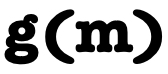

# Gammath SPOT

**S**tock **P**rice-**O**pining **T**oolset (SPOT) is a do-it-yourself stock technical analysis toolkit with both a Graphical User Interface (GUI) and a Command Line Interface (CLI). It analyzes stocks and computes a proprietary analysis score called the **gScore** (pronounced "*ga Score*"), short for Gammath Works' stock analysis score. The gScore indicates the degree to which a stock is trading at a perceived discount or a perceived premium.

SPOT also provides tools for price projection, gScore history generation, backtesting, stock screening and trade simulation. Together, these tools can help you make your own stock-specific buy, hold and sell decisions.

> **Note:** gScore is **not** G-Score, GScore, G Score or g-score. It differs in usage, appearance, spelling, pronunciation and meaning, and is built on its own distinct stock analysis and scoring system.

---

## Table of Contents

- [Features](#features)
- [Requirements](#requirements)
- [Installation](#installation)
- [Using Docker](#using-docker)
- [Usage](#usage)
  - [Graphical User Interface](#graphical-user-interface)
  - [Command Line Interface](#command-line-interface)
- [Troubleshooting](#troubleshooting)
- [Resources](#resources)
- [Contact and Contributing](#contact-and-contributing)

---

## Features

| Tool | Description |
|------|-------------|
| **Data Scraper** | Collects the stock data required for algorithmic analysis and scoring. |
| **Analyzer and Scorer** | Analyzes the locally saved stock data and computes gScores. gScores range from **-1** to **+1**: values closer to -1 indicate that the stock is perceived to be trading at a premium, while values closer to +1 indicate that it is perceived to be trading at a discount. |
| **Price Projector** | Estimates and projects prices over an approximately five-year time frame. |
| **Screener** | Screens stocks based on current-information micro-gScores (fundamental analysis and options analysis). |
| **gScores Historian** | Generates gScore and micro-gScore history for correlation analysis and backtesting. |
| **Backtester** | Tests a trading strategy against historical data and reports how it performed. It also generates a "Today's Actions" summary for the default strategy, so the entire analysis and decision-making process can be automated. |
| **GUI** | An all-in-one graphical interface to the entire toolset. |
| **Trading Simulator** | A reinforcement learning (RL) trading agent that trains on gScore history and recommends actions *(work in progress)*. |

All tools take a watchlist as input. A sample is provided in [sample_watchlist.csv](https://github.com/salylgw/gammath_spot/blob/main/gammath_spot/sample_watchlist.csv), which you can modify to create your own watchlist.

---

## Requirements

- **Python 3.12**
- The following packages (installed automatically with `pip install gammath-spot`):
  - numpy
  - pandas
  - pandas_datareader
  - yfinance
  - scikit-learn
  - matplotlib
  - tensorflow
  - tensorboard
  - keras-tuner
  - gymnasium

---

## Installation

### Install from PyPI

After installing Python 3.12, run:

```bash
pip install gammath-spot --prefer-binary
```

### Get the source code (without installing)

```bash
git clone https://github.com/salylgw/gammath_spot.git
```

> **Tip:** If you are a new user, or would like to try Gammath SPOT without setting up a local environment, we recommend starting with the prebuilt Docker image and the CLI. This lets you get familiar with the tools quickly without worrying about local environment issues. See the [instructional videos](https://youtube.com/playlist?list=PLck0jfgap9AT3Qd1mcNgr5KguIXrW9BD4) and the [Using Docker](#using-docker) section below.

---

## Using Docker

### Get the prebuilt image

1. Install [Docker Desktop](https://docs.docker.com/get-docker) (macOS or Windows) or Docker Engine (Linux).
2. Start Docker.
3. Open a terminal (macOS/Linux) or PowerShell (Windows).
4. Pull the image:

   ```bash
   docker pull gammathworks/gammath_spot
   ```

### Run the container (CLI)

1. Start Docker Desktop or Docker Engine.
2. Open a terminal or command prompt.
3. Run:

   ```bash
   docker run -i -t -e TZ="America/Los_Angeles" --mount type=volume,source=gammath_spot_vol,target=/gammath_spot/gammath_spot gammathworks/gammath_spot /bin/bash
   ```

   Replace the `TZ` value to match your time zone.
4. At the container prompt, run `pwd`. It should print `/gammath_spot/gammath_spot`. Running `ls` should list all the `.py` files. You are now ready to run the Gammath SPOT commands described in [Usage](#usage).

### Build your own image

1. Install and start Docker, then open a terminal as described above.
2. Place this [Dockerfile](https://github.com/salylgw/gammath_spot/blob/main/Dockerfile) in the directory where you want to build the image.
3. Build the image (note the trailing `.`):

   ```bash
   docker build --no-cache=true --tag=gammathworks/gammath_spot .
   ```

4. Run the container as described in [Run the container (CLI)](#run-the-container-cli).

### Copy data from Docker Desktop to your computer

*The exact steps may vary slightly depending on your Docker Desktop version and environment.*

1. Open Docker Desktop and click **Volumes**.
2. Click the volume name, then click **Data**.
3. Scroll down to the `tickers` directory.
4. Hover over `tickers`, click the three-dot menu on the right, and select **Save as**.
5. Click **Save**, then unzip the downloaded `tickers.zip` file.
6. Open the files with your preferred applications (e.g., Excel, Acrobat).

---

## Usage

All commands below write their log to a text file via `>` redirection. If you **installed** the package, use the console command (e.g., `gammath_scraper`). If you are running from **source**, change to the `gammath_spot/gammath_spot/` directory and use the corresponding `python` command. Both forms work inside the prebuilt Docker container.

### Graphical User Interface

> **Note:** The GUI is **not supported** in the Docker container.

| Installed | From source |
|-----------|-------------|
| `gammath_spot_gui > log_gui.txt` | `python gammath_gui_app.py > log_gui.txt` |

The GUI is self-explanatory: it lets you run the tools, manage watchlists, run screeners, view results and more, without using any of the CLI commands below. The output locations described in the CLI section still apply, so you can also browse the data and results directly with native applications such as a file explorer, spreadsheet program or PDF viewer.

### Command Line Interface

#### 1. Scrape stock data

| Installed | From source |
|-----------|-------------|
| `gammath_scraper sample_watchlist.csv > log_scraper.txt` | `python gammath_stocks_data_scraper.py sample_watchlist.csv > log_scraper.txt` |

The scraped and formatted data, along with a reference `SP500_watchlist.csv` based on the S&P 500, is saved in the `tickers` subdirectory. **Running the scraper is required before using any of the other tools.**

#### 2. Analyze and score

| Installed | From source |
|-----------|-------------|
| `gammath_scorer sample_watchlist.csv > log_scorer.txt` | `python gammath_stocks_analyzer_and_scorer.py sample_watchlist.csv > log_scorer.txt` |

Analysis and scoring results are saved in the `tickers` and `tickers/<ticker-symbol>` subdirectories.

- **`tickers/<watchlist_name>_overall_gscores.csv`** (e.g., `sample_watchlist_overall_gscores.csv`): Stocks from your watchlist sorted in ascending order of gScore. This file also includes:
  - `sh_gscore`: the stock-history-based gScore
  - `sci_gscore`: the current-information-based gScore

  Together, `sh_gscore` and `sci_gscore` make up the overall gScore. If you are not interested in backtesting or sub-component scores, you can ignore them.
- **`tickers/<ticker-symbol>/<ticker-symbol>_signal.txt`**: Detailed analysis results.
- **`tickers/<ticker-symbol>/<ticker-symbol>_charts.pdf`**: Plotted charts.
- **`tickers/<ticker-symbol>/<ticker-symbol>_tc.pdf`**: Current moving estimated support and resistance lines.

#### 3. Project prices

| Installed | From source |
|-----------|-------------|
| `gammath_projector sample_watchlist.csv > log_projector.txt` | `python gammath_stocks_pep.py sample_watchlist.csv > log_projector.txt` |

- **`tickers/<ticker-symbol>/<ticker-symbol>_pp.csv`**: Projected price values. S&P 500 projections are saved in the `tickers` directory.
- **`tickers/MPEP.csv`**: A sorted list of moving estimated projected five-year returns.

#### 4. Screen stocks

| Installed | From source |
|-----------|-------------|
| `gammath_screener screener.csv > log_screener.txt` | `python gammath_stocks_screener.py screener.csv > log_screener.txt` |

Screens stocks based on the current-information micro-gScores computed by the scorer: the **fundamental analysis** (`FAST`) and **options analysis** (`Options`) micro-gScores. The minimum value for each micro-gScore is specified in `screener.csv`, and every stock in the `tickers` directory that meets both minimums is included in the results. Run the scraper and scorer first.

- **`tickers/screened_watchlist.csv`**: The screened list of stocks, which can also be used as a watchlist for the other tools.

#### 5. Generate gScore history

| Installed | From source |
|-----------|-------------|
| `gammath_historian sample_watchlist.csv > log_historian.txt` | `python gammath_stocks_gscores_historian.py sample_watchlist.csv > log_historian.txt` |

Use this tool to generate historical gScores for correlation analysis, past-performance review and backtesting. **The first run takes a long time**, so limit the watchlist to a few stocks you want to study closely.

- **`tickers/<ticker-symbol>/<ticker-symbol>_micro_gscores.csv`**: Stock-history-based micro-gScores and the corresponding total gScore.
- **`tickers/<ticker-symbol>/<ticker-symbol>_gscores_charts.pdf`**: Charts of price, overall stock-history-based gScore and micro-gScores.

#### 6. Backtest a strategy

| Installed | From source |
|-----------|-------------|
| `gammath_backtester sample_watchlist.csv > log_backtester.txt` | `python gammath_stocks_backtesting.py sample_watchlist.csv > log_backtester.txt` |

For each stock, the backtester applies a strategy to the scraped data and the stock-history-based gScores/micro-gScores (generated by the historian) for approximately the last five years. You can modify the strategy function locally to implement your own.

- **`tickers/<ticker-symbol>/<ticker-symbol>_gtrades_stats_<term>_<risk>_risk_appetite.csv`**: Backtesting statistics, where `<term>` is `short_term` or `long_term` and `<risk>` is `medium` or `high`. Use these statistics to judge whether a strategy has worked historically before deciding to use it.
- **`tickers/Todays_Actions.csv`**: A sorted "Today's Actions" summary based on the default backtested strategy.

#### 7. Run the trading simulator *(work in progress)*

> **Note:** The SPOT RL trading simulator is experimental and has had limited testing.

| Installed | From source |
|-----------|-------------|
| `gammath_trading_simulator sample_watchlist.csv > log_trader.txt` | `python gammath_spot_rl_gym_env.py sample_watchlist.csv > log_trader.txt` |

Optional arguments: `--retrain` (force retraining even if a saved model exists), `--episodes <n>` and `--test_days <n>`. Run with `--help` for details.

- **`tickers/<ticker-symbol>/<ticker-symbol>_rl_signals.csv`**: Per-stock RL signals.
- **`tickers/<watchlist_name>_rl_signals.csv`**: Watchlist-level summary for daily review.

---

## Troubleshooting

### "Command not found" after installation

The installer normally adds the console scripts (`gammath_scraper`, `gammath_scorer`, `gammath_projector`, `gammath_historian`, `gammath_backtester`, `gammath_screener`, `gammath_trading_simulator` and `gammath_spot_gui`) to your `PATH`. In some setups this does not happen, and you will need to add the scripts' install location to your `PATH` manually.

### Scraper fails on macOS due to a certificate error

1. Open **Applications → Python 3.12**.
2. Run **Install Certificates.command** as an administrator.
3. Exit the administrator session.

### Docker environment issues

- **Out of disk space when pulling the image:** Run `docker image prune -f` to remove unused images.
- **Signature mismatch error for a component image when building your own image:** Run `docker builder prune -f` to clear the build cache.
- In general, use the latest versions of Docker Desktop and gammath-spot.

---

## Resources

- **[DIY Investment Blog](https://www.gammathworks.com/diy-investment-blog):** Free examples of how gScores are used in manual investment decision-making.
- **[Instructional videos](https://youtube.com/playlist?list=PLck0jfgap9AT3Qd1mcNgr5KguIXrW9BD4):** Getting started with the prebuilt Docker image.

---

## Contact and Contributing

If you have questions, please reach out using this [contact form](https://www.gammathworks.com/contact).

This version of Gammath SPOT is free and open source. If you would like to contribute your expertise in Python and/or finance and investing, please get in touch through the [contact form](https://www.gammathworks.com/contact) and describe your areas of interest and expertise. See also [CONTRIBUTING.md](CONTRIBUTING.md) and [CODE_OF_CONDUCT.md](CODE_OF_CONDUCT.md).

---

**Happy SPOTing!**

<p align="center"><sub><em>Gammath, SPOT and the stylized  logo are registered trademarks/service marks.</em></sub></p>
